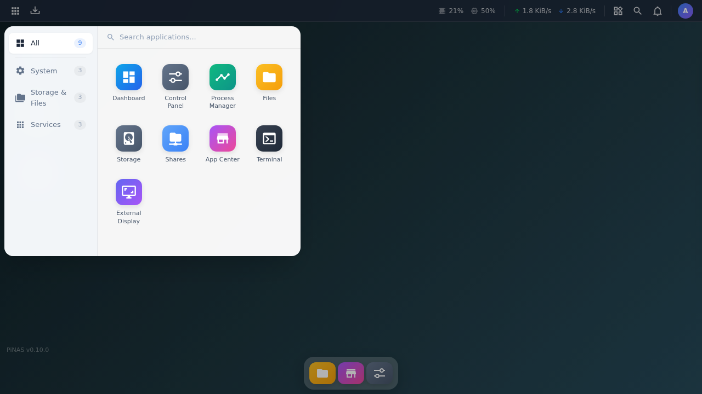
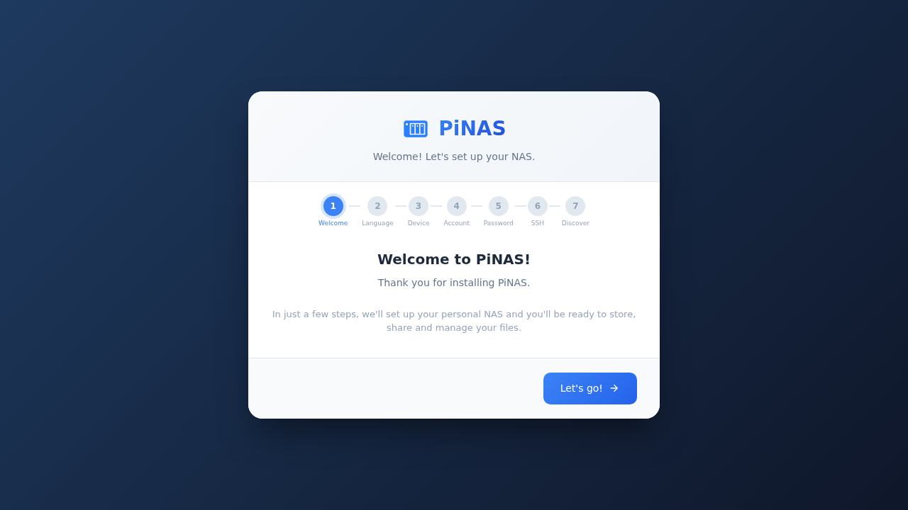
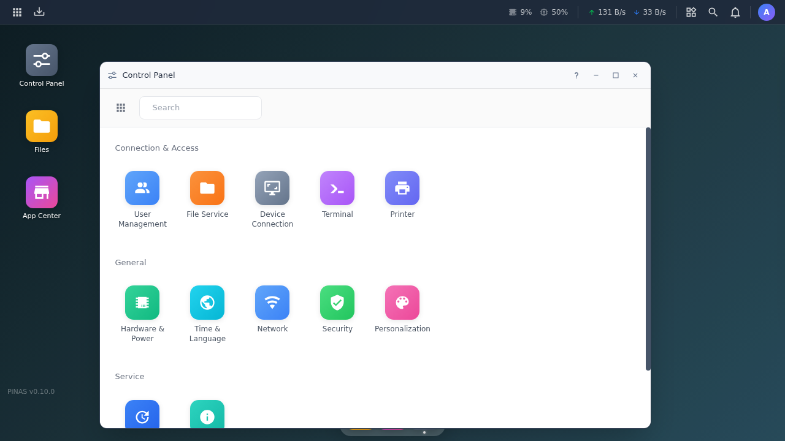
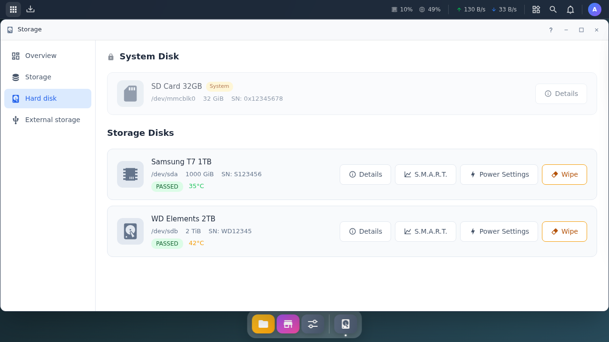
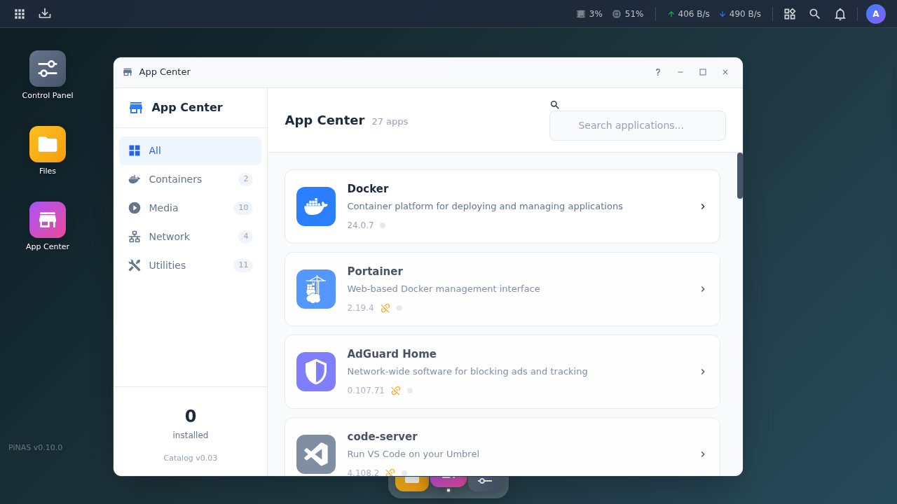

<div align="center">

# PiNAS

**A modern NAS operating system for the Raspberry Pi 5, side by side with Kodi.**

PiNAS turns a Raspberry Pi 5 (or any x86_64 PC / virtual machine) into a full NAS with a desktop-like web interface inspired by Synology DSM. It ships as a native LibreELEC package, so one small box is both your media center and your file server.

[](https://github.com/kameka22/pinas/actions/workflows/ci.yml)
[](https://github.com/kameka22/pinas/actions/workflows/build-libreelec.yml)
[](LICENSE)


[Features](#features) · [Screenshots](#screenshots) · [Install](#install) · [Development](#development) · [Documentation](#documentation) · [Roadmap](#roadmap)



</div>

> [!WARNING]
> PiNAS is under active development and has **no stable release yet** (current version: `0.10.0`). Test it on hardware and disks that hold no data you cannot afford to lose.

## Why PiNAS?

- **One box, two jobs.** Kodi keeps playing your media while PiNAS serves files, runs apps and watches your disks — no second machine, no second OS.
- **A real NAS interface, not a config file.** Windows, a dock, widgets, global search and a control panel, in English and French.
- **Built for small hardware.** A static Rust backend and a pre-rendered Svelte frontend: about 50 MB of RAM and 100 MB of disk.
- **Secure by default.** Every API route is authenticated, sessions can be revoked, logins are rate-limited and system updates are signature-checked (Ed25519) before they are installed.

## Features

| Area | What you get |
|------|--------------|
| **Desktop** | Windows, dock, top bar, widgets panel, global search (`Ctrl+K`), notification center, wallpapers |
| **Storage** | Pools in RAID 0/1/5/10, JBOD or Btrfs, volumes, S.M.A.R.T. health, disk power settings, external USB storage |
| **Files** | Browse, upload, download (files or zipped folders), preview, rename, drag & drop, search across locations |
| **Sharing** | SMB/Samba shares and NFS exports (per-client access, read-only/read-write, root squash) |
| **Users** | Users and groups with per-folder permissions, personal home folders |
| **Apps** | App Center with [27 Docker apps](#app-center), including multi-container apps through Docker Compose |
| **System** | Network (interfaces, DNS, hostname), SSH, CUPS printer sharing (IPP/AirPrint), CPU governor, scheduled reboot/shutdown, time & language |
| **Monitoring** | Live CPU, RAM, network and disk usage over WebSocket, process manager, web terminal |
| **Security** | Login audit, session lifetime, password policy, optional HTTPS (self-signed), signed over-the-air updates |
| **Setup** | 7-step onboarding wizard: language, device name, admin account, password, SSH, features |

## Screenshots

| | |
|---|---|
|  |  |
| **Onboarding** — first boot in a few steps | **Control panel** — every system setting in one place |
|  |  |
| **Storage** — disks, S.M.A.R.T. and pools | **App Center** — one-click Docker apps |

<sub>Screenshots taken in development mode, where disks and system services are simulated.</sub>

## Install

### Supported hardware

| Target | Image | Notes |
|--------|-------|-------|
| **Raspberry Pi 5** (4 GB RAM or more recommended) | `LibreELEC-RPi5.aarch64-*.img.gz` | microSD card (16 GB+) for the system, USB or NVMe disks for data |
| **x86_64 PC or virtual machine** | `LibreELEC-Generic.x86_64-*.img.gz` and `pinas-x86_64-<version>.ova` | VMware, VirtualBox, Proxmox, Synology VMM, QEMU/KVM. Add virtual disks for the storage pools. S.M.A.R.T., disk power management and the CPU governor are not available on virtual hardware |
| ARM64 virtual machine (UTM on Apple Silicon, QEMU) | — | Not available yet: see [Roadmap](#roadmap) |

### Get an image

- **Releases** — images will be published on the [Releases page](https://github.com/kameka22/pinas/releases) from the first stable version.
- **Until then** — every run of the [image build workflow](https://github.com/kameka22/pinas/actions/workflows/build-libreelec.yml) attaches the images as artifacts (kept 7 days). Open the latest successful run and download `libreelec-pinas-image-rpi5` or `libreelec-pinas-image-x86_64` from the *Artifacts* section (you need to be signed in to GitHub).
- **Build it yourself** — see [Build an image](#build-an-image).

### Raspberry Pi 5

1. Flash the image to a microSD card, with [Raspberry Pi Imager](https://www.raspberrypi.com/software/) (*Use custom*) or from a terminal:
   ```bash
   gunzip -c LibreELEC-RPi5.aarch64-*.img.gz | sudo dd of=/dev/sdX bs=4M status=progress conv=fsync
   ```
2. Insert the card, plug in your data disks and power on the Pi.
3. Open `http://<pi-ip>:3000` from a computer on the same network (the IP is shown in Kodi under *Settings → System information*).
4. Follow the onboarding wizard to create the administrator account.

### Virtual machine (x86_64)

1. Import `pinas-x86_64-<version>.ova` into your hypervisor (VirtualBox: *File → Import Appliance*).
2. Set the network to **bridged** so the VM gets an address on your LAN, and add one or more virtual disks for storage pools.
3. Start the VM and open `http://<vm-ip>:3000`. If it does not boot, enable EFI in the VM settings.

> HTTPS is off by default. Turn it on in *Control Panel → Security* to serve PiNAS over HTTPS with a self-signed certificate.

## App Center

27 apps from the [PiNAS app catalog](https://github.com/kameka22/pinas-app-catalog), installed in one click. Docker itself is not built in: it is installed from the App Center like any other app.

| Category | Apps |
|----------|------|
| **Containers** | Docker, Portainer |
| **Media** | Plex, Jellyfin, Emby, Sonarr, Radarr, Lidarr, qBittorrent, Transmission, SABnzbd, PhotoPrism |
| **Network** | Pi-hole, AdGuard Home, WireGuard, Nginx Proxy Manager |
| **Utilities** | Nextcloud, Home Assistant, Syncthing, Vaultwarden, Grafana, Uptime Kuma, File Browser, Code Server, Node-RED, Paperless-ngx, Duplicati |

## How it works

```
┌──────────────────────── LibreELEC (read-only system) ────────────────────────┐
│                                                                              │
│   Kodi (media center)        PiNAS backend — Rust, Axum + Tokio, :3000       │
│                              ├─ REST API + WebSocket (JWT sessions)          │
│                              ├─ serves the web UI (SvelteKit, pre-rendered)  │
│                              └─ drives Samba, NFS, CUPS, Docker, mdadm, …    │
│                                                                              │
│   /storage (writable)  ── .pinas/data (SQLite, secrets)  ·  pools/ (disks)   │
└──────────────────────────────────────────────────────────────────────────────┘
```

| Component | Technology |
|-----------|------------|
| Host OS | [LibreELEC](https://libreelec.tv) 12.x — PiNAS is built into the image as a native package |
| Backend | Rust (Axum + Tokio), static musl binary, SQLite |
| Frontend | SvelteKit + Svelte 5 (static build), TailwindCSS 4, Iconify icons, i18n (English, French) |
| Updates | Signed release archives (Ed25519 over SHA-256), checked by the Pi before install |
| CI | GitHub Actions: tests, type-check, version consistency, Raspberry Pi 5 and x86_64 images |

## Development

You do not need a Raspberry Pi to work on PiNAS: **development mode** (`PINAS_DEV_MODE=true`) simulates disks, pools, services and packages.

**Requirements:** Docker with Compose v2 (no local Rust toolchain needed). Node.js 26+ only if you run the frontend outside Docker.

```bash
git clone https://github.com/kameka22/pinas.git
cd pinas
./scripts/start.dev.sh -d      # backend (dev mode, :3388) + frontend with hot reload (:5173)
```

Open <http://localhost:5173>: the onboarding wizard runs on first start. `./scripts/start.dev.sh reset` starts again from an empty database, `stop` and `logs` do what they say.

Every project script is also reachable from one entry point: `./scripts/pinas.sh` (interactive menu), `./scripts/pinas.sh list`, or `./scripts/pinas.sh <name> [args]`.

### Checks

```bash
./scripts/pinas.sh check       # cargo test, cargo check -D warnings, svelte-check, vitest, frontend build, VERSION consistency
```

CI runs `cargo test --locked`, `cargo clippy --all-targets -- -D warnings`, `npm run check`, `npm test` and `scripts/sync-version.sh --check` on every pull request.

### Build an image

Image builds run on Linux (native ARM64 or x86_64) and take a few hours the first time.

```bash
./scripts/build-arm64.sh                # Raspberry Pi 5 → .img.gz
./scripts/build-x86.sh                  # x86_64 → .img.gz + .ova
./scripts/remote-build.sh --arch x86    # same, on a remote Linux VM over SSH
```

Common options: `--backend-only`, `--frontend-only`, `--skip-libreelec`, `--clean`. Details, CI pipeline and troubleshooting: [BUILD.md](BUILD.md).

### Deploy to a Pi

```bash
./scripts/deploy-pi.sh          # hot-deploy the backend and frontend over SSH
./scripts/connect-pi.sh         # find the Pi on the LAN and open an SSH session
```

### Project layout

```
├── backend/          Rust API (Axum): api/, services/, models/, migrations/
├── frontend/         SvelteKit UI: desktop shell, apps, stores, i18n
├── libreelec/        LibreELEC integration
│   ├── packages/     pinas, pinas-nfs-server, cups
│   ├── kernel/       kernel config fragments (NFS server)
│   └── BRANCH        target LibreELEC branch
├── scripts/          build, release, deploy and dev scripts
├── docker/           development environment (Docker Compose)
├── installer/        installer (Rust)
└── docs/             release checklist, screenshots, design notes
```

## Documentation

| Document | Content |
|----------|---------|
| [BUILD.md](BUILD.md) | Building images locally and in CI, troubleshooting |
| [STORAGE_MANAGER.md](STORAGE_MANAGER.md) | Storage pools, RAID and volumes design |
| [docs/RELEASE_CHECKLIST.md](docs/RELEASE_CHECKLIST.md) | Hardware validation of each release on a Pi 5 |
| [SECURITY.md](SECURITY.md) · [SECURITY_AUDIT.md](SECURITY_AUDIT.md) | Reporting vulnerabilities · past audit findings |
| [REMEDIATION_PLAN.md](REMEDIATION_PLAN.md) · [TODO.md](TODO.md) | Engineering roadmap and open work |
| [CLAUDE.md](CLAUDE.md) | Contributor notes: architecture, code conventions, configuration variables |

## Roadmap

**Next**
- First stable release, validated on a Raspberry Pi 5 ([checklist](docs/RELEASE_CHECKLIST.md))
- Real-time Storage Manager updates over WebSocket
- Bootable ARM64 virtual machine image (UTM on Apple Silicon, QEMU)
- Dark theme, metrics history (1 h / 1 d / 1 w graphs)

**Later**
- Backup and sync: rsync jobs, USB backup on plug, cloud sync (rclone)
- Email alerts (S.M.A.R.T., disk space), scheduled tasks
- Firewall, disk quotas, Let's Encrypt certificates, Wake-on-LAN
- UPS support (NUT), SNMP, remote syslog
- Volume resize, LVM, SSD caching, S3-compatible storage

Not planned: an FTP/SFTP server (LibreELEC has a single Unix account; SFTP is available for root over SSH).

## Contributing

Issues and pull requests are welcome. Work on a branch (`feature/…`, `fix/…`), use [Conventional Commits](https://www.conventionalcommits.org) (`feat:`, `fix:`, `docs:`, …) and make sure `./scripts/pinas.sh check` passes. The version lives in a single file, `VERSION`; `scripts/sync-version.sh` propagates it.

## License

PiNAS is free software under the [GNU General Public License v3.0](LICENSE). It is not affiliated with Synology, LibreELEC or the Kodi Foundation.
